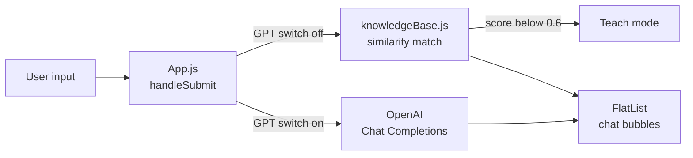

# Travel Assistant Chatbot

A React Native chat app that answers small talk from a local knowledge base and travel questions with GPT-3.5.


## 📖 About

A mobile chatbot with two brains and a switch between them. With GPT off, it matches your message against a small built-in knowledge base and asks you to teach it when it has no answer. With GPT on, it sends the whole conversation to OpenAI with a system prompt that makes it a travel assistant for trips starting in India. I built it to compare a hand-rolled rule-based bot with an LLM in the same chat UI.

## ✨ Features

- **"Enable GPT 3.5" switch** at the top of the chat that flips between local and AI replies (`App.js`)
- **Local mode**: scores your message against every question in `knowledgeBase.js` with a character-position similarity function and replies when the best score is at least 0.6
- **Teach mode**: when nothing matches, the bot asks you for the answer and builds a new question and response pair from your reply. Saving that pair back into the knowledge base is not implemented yet. Type `/skip` to leave teach mode
- **GPT mode**: calls the OpenAI Chat Completions API (`gpt-3.5-turbo`, `max_tokens` 1000, `temperature` 0.8) with a travel-assistant system prompt plus the full chat history, so follow-up questions keep their context
- **`/clear`** resets the conversation in either mode
- Separate bot and user chat bubbles in a `FlatList` (`MessageBoxBot`, `MessageBoxUser`)
- EAS build profiles, including an Android APK preview build (`eas.json`)

## 🧰 Tech stack

| Area | Tools |
| --- | --- |
| App | React Native 0.73, Expo SDK 50, React 18 |
| Networking | axios |
| AI | OpenAI Chat Completions API (GPT-3.5 Turbo) |
| UI | React Native core components, react-native-safe-area-context, expo-status-bar |
| Build | Expo Application Services (EAS) |

## 🏗️ Architecture



Every message goes through `handleSubmit` in `App.js`. In local mode it is lowercased and scored against each stored question, and the best response wins if it clears the threshold. In GPT mode the app builds a messages array of system prompt, prior turns and the new message, posts it with axios, and appends the assistant reply to state.

```
chatbot/
├── App.js                  # chat screen, mode switch, matching and OpenAI call
├── src/
│   ├── components/         # MessageBoxBot, MessageBoxUser
│   └── data/               # knowledgeBase (Q&A pairs), messageData (greeting)
├── app.json
└── eas.json
```

## 🚀 Getting started

Prerequisites: Node.js 18+, the Expo Go app or an emulator, and an OpenAI API key for GPT mode.

```bash
git clone https://github.com/nam710/chatbot.git
cd chatbot
npm install
cp .env.example .env    # add your own key
npx expo start
```

`.env.example`:

```
EXPO_PUBLIC_OPENAI_API_KEY=
```

Expo inlines `EXPO_PUBLIC_` variables into the app bundle, so this setup is for local experiments only. A production build should route requests through a small backend that holds the key.

## 💡 What I learned

- Writing a simple string-similarity matcher and choosing a threshold that separates a real match from noise.
- Sending conversation history with a system prompt to the Chat Completions API so the model keeps context across turns.
- Managing chat state with functional `setState` updates so async API replies do not overwrite newer messages.
- Keeping API keys out of source with Expo's `EXPO_PUBLIC_` environment variables, and why a bundled key is still public.

## 📌 Status

Built in 2024. Not actively maintained, and dependencies may need updating.

---

Built by Naman Chawla with [Shashwat Gupta](https://github.com/Gupta-Shashwat) and [Abhinav](https://github.com/me-AC) · [LinkedIn](https://www.linkedin.com/in/naman-chawla-63529b21b)
